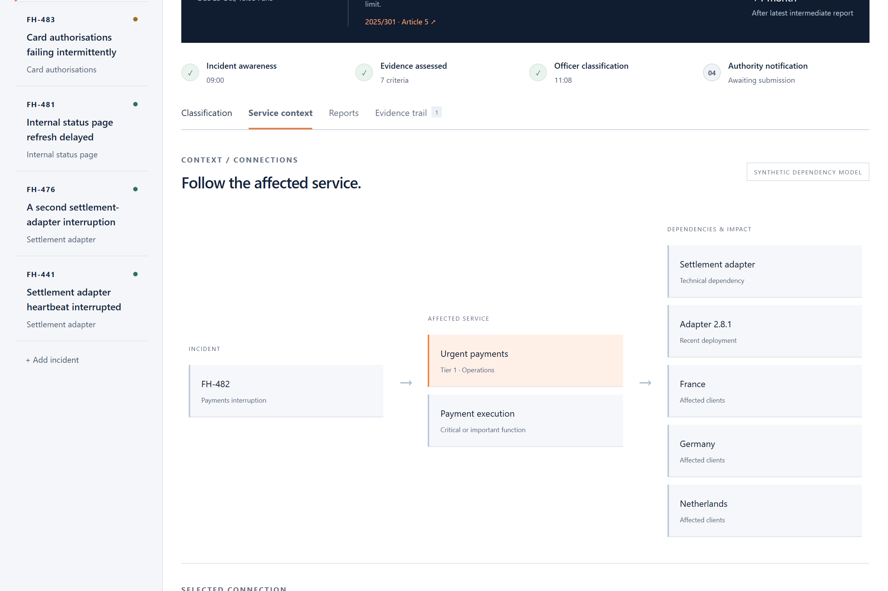
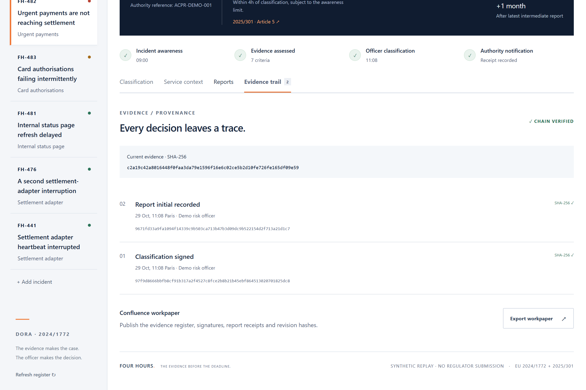
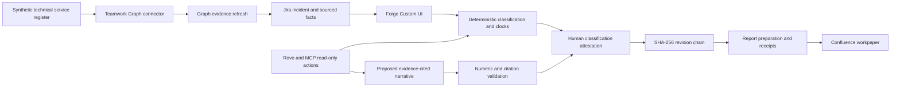

  

**Four Hours gives an ICT risk officer a sourced DORA incident classification and the reporting deadlines that follow it.**

I audit bank technology, payment systems and business continuity. I built the desk around the decision an incident manager and risk officer have to make while a payment service is down.

| | |
|---|---|
| Try the replay | [Open the incident desk](https://marc-dvci.github.io/four-hours/) |
| Track | Codegeist 2026 · Apps for Specialized Industries |
| Built with | Forge, Jira, Confluence, Teamwork Graph connector SDK, Rovo agent and MCP modules, TypeScript, React |
| Measured | 38/38 labelled synthetic classification cases; 127 unit tests; 9 browser workflows |
| Run locally | `npm ci && npm run dev` |

## For judges

| Criterion | Evidence |
|---|---|
| Technological implementation | [Forge manifest](manifest.yml), [runtime adapters](src/forge), [authenticated resolvers](src/index.ts), [setup](docs/setup.md) |
| Design | The working replay, [browser workflows](e2e/desk.spec.ts), [axe-core report](eval/reports/accessibility.json) |
| Potential impact | One risk officer, a payment interruption, seven sourced criteria and four reporting stages |
| Innovation | Critical-services gateway, grouped thresholds, missing-evidence logic and six-month recurrence in the same decision flow |
| Presentation | [Product screenshots](docs/images), [rule sources](docs/SOURCES.md), [reproducible results](eval/reports/RESULTS.md) |

## See it work

1. Open FH-482. Expand Clients & transactions to inspect the impact and its source. The critical-services gateway and three materiality groups are met.
2. Sign the classification. Open Reports, prepare the initial notification, and record a demo authority receipt. Its submission timestamp starts the intermediate deadline.
3. Open FH-476 and check recurring incidents. The earlier incident has the same service and apparent root cause; their distinct costs and geographical impact establish a collective major assessment.
4. On Evidence trail, verify the hash chain and export the workpaper.





## The problem

The reporting deadline depends on decisions and events outside a conventional SLA timer: the officer's classification, the institution's awareness, the actual initial submission and the latest intermediate report. The classification itself depends on a critical-services gateway and grouped materiality thresholds. Missing evidence can change whether the incident is major.

Four Hours places those decisions on the incident record. Each criterion has a value, observation time, source, evidence URL and legal reference. The officer can inspect the inputs, correct the context and sign the exact evidence version.

## How it works



Code computes verdicts, deadlines and hashes. A person signs the classification and reviews any proposed narrative.

The core follows [2024/1772 Articles 6, 8 and 9](https://eur-lex.europa.eu/legal-content/EN/TXT/?uri=CELEX%3A32024R1772). It distinguishes the special malicious-access route from adverse data impact, counts client and transaction thresholds once, and preserves unknown evidence. Reporting implements [2025/301 Article 5](https://eur-lex.europa.eu/eli/reg_del/2025/301/oj/eng), including late classification and calendar months. GDPR uses a separate breach-awareness time and risk test.

## Atlassian integration

| Capability | Role in the implementation |
|---|---|
| Jira issue panel and global page | The incident desk inside the work system |
| Forge resolver and current-user Jira API | Read access and edit permissions checked for each incident; authenticated identity supplies the actor |
| Forge custom-entity storage | Conditional transactions protect concurrent record versions |
| Teamwork Graph connector SDK | Upserts synthetic technical services, checks rejected objects and reads service metadata back into a sourced demo fact |
| Confluence API | Publishes the officer's workpaper under the current user's permissions |
| Rovo agent and MCP | Two read-only evidence and recurrence tools; the same deterministic assessment serves both |

The standalone replay uses the same domain code and a browser-local store. Its dependencies and incident inputs are explicitly synthetic.

## Approvals and evidence

An incomplete assessment cannot be signed. Changes to signed evidence require a fresh attestation, while the original major-classification deadline is retained. Receipts require chronological stages and distinct authority references. Report preparation and actual authority submission are recorded separately. Revision hashes detect changes to recorded evidence.

## Measurements

| Check | Result | Reproduce |
|---|---|---|
| Legal-boundary corpus | 38/38 correct: 17 major, 17 not major, 4 incomplete | `npm run eval` |
| Domain, permissions, projections and cost policy | 127 passing tests | `npm test` |
| Browser workflows | 9 passing workflows | `npm run test:browser` |
| Accessibility | No axe-core WCAG A/AA violations in four sections, the signature dialog and mobile view | `npm run test:browser` |
| Dependency audit | Zero advisories in the saved dependency audit | `npm audit` |
| Build and manifest | TypeScript build and offline Forge schema validation | `npm run audit` |

The corpus is a regression set of labelled synthetic legal-boundary cases. One secondary label was corrected after a legal-logic review; it is not a blind accuracy study. The report records the corpus hashes.

## Claims map

| Claim | Code | Verification |
|---|---|---|
| Client and transaction sub-thresholds count once | `src/core/classify.ts` | `one-clients-group` |
| Data impact alone is not the special major route | `src/core/classify.ts` | `data-a-alone`, `malicious-special-route` |
| Unknown evidence is preserved | `src/core/classify.ts` | `unknown-can-change`, `zero-denominator` |
| Late classification has a separate four-hour rule | `src/core/clocks.ts` | `clocks.test.ts` |
| Final report uses a calendar month | `src/core/clocks.ts` | January, leap-year and DST cases |
| Renewed signatures preserve the original clock | `src/core/ledger.ts` | `ledger.test.ts`, `context.test.ts` |
| A forged payload cannot choose the actor | `src/forge/access.ts` | `access.test.ts`, `ledger.test.ts` |
| Narrative numbers must match cited facts | `src/core/reports.ts` | `reports.test.ts` |
| The graph projection excludes impact and customer facts | `src/forge/graph.ts` | `graph.test.ts` |
| Metered deployment is blocked without verified protection | `scripts/deploy.ts` | `cost-policy.test.ts` |

## Quickstart

```sh
npm ci
npm run dev
# Open http://127.0.0.1:4173
npm run audit
npm run test:browser
```

See [setup](docs/setup.md) for Docker and Forge installation, [sources](docs/SOURCES.md) for legal interpretations, and [cost controls](docs/COSTS.md) for the deployment gate.

`src/core` contains the decision engine, clocks, ledger and reports. `src/forge` contains platform adapters. `src/frontend` contains the incident desk. `eval` contains labelled cases and results. `manifest.yml` declares the Forge infrastructure. MIT licensed.

## Release boundary

The replay is functional and uses synthetic evidence. The Forge adapters are implemented and schema-validated; a live install and target-platform verification are gated until a billing-exempt destination or provider-enforced spending cap is verified. An authorised officer reviews regulatory scope and the competent authority's current form before using a prepared report.
