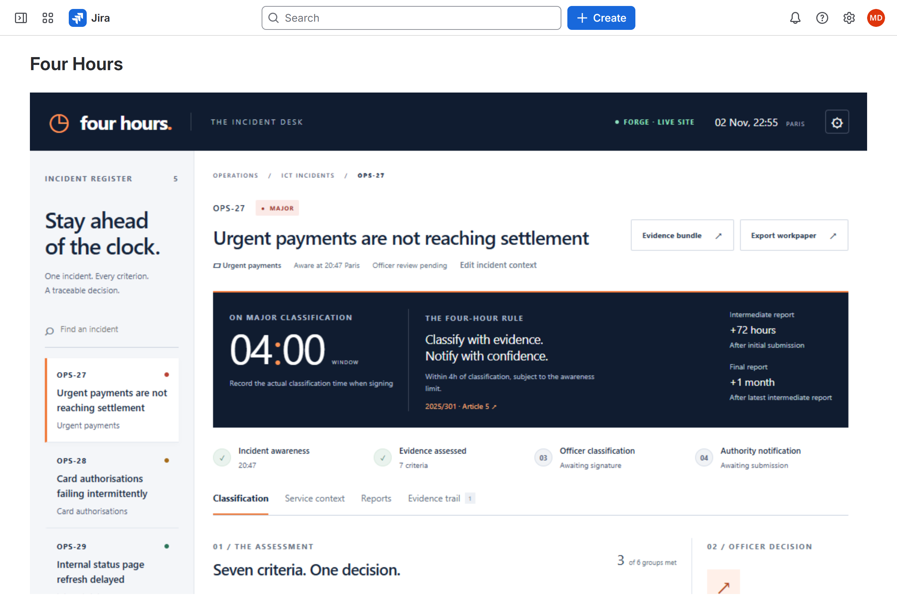
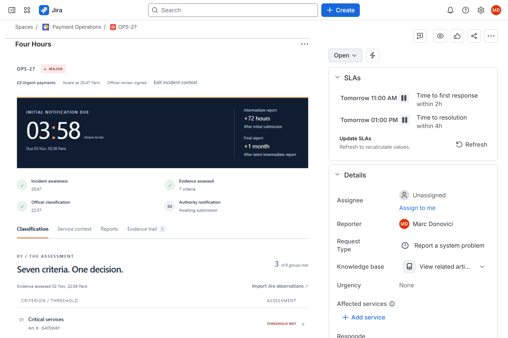
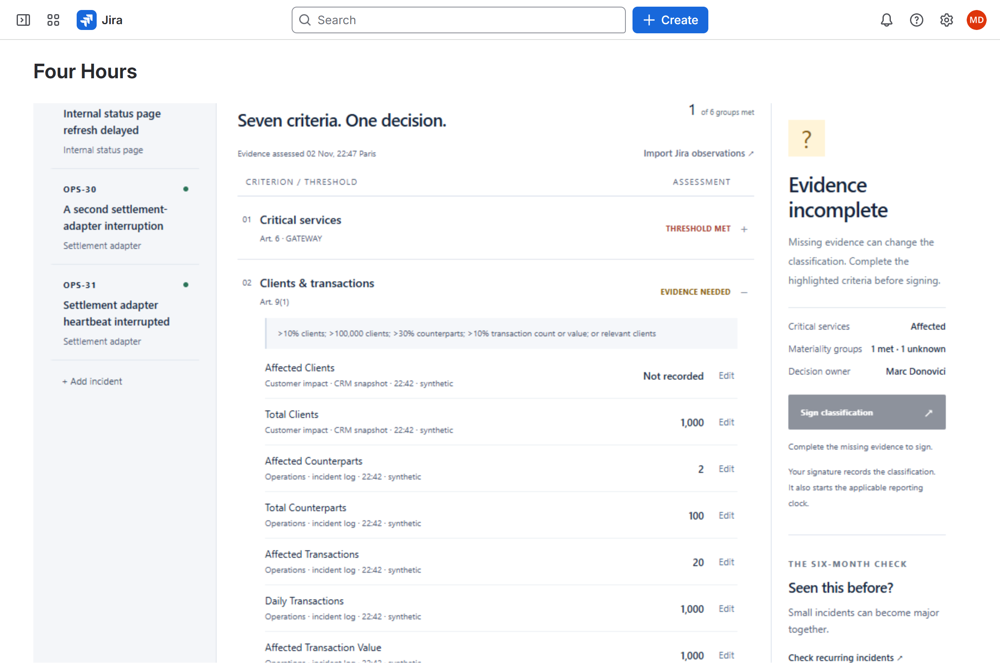
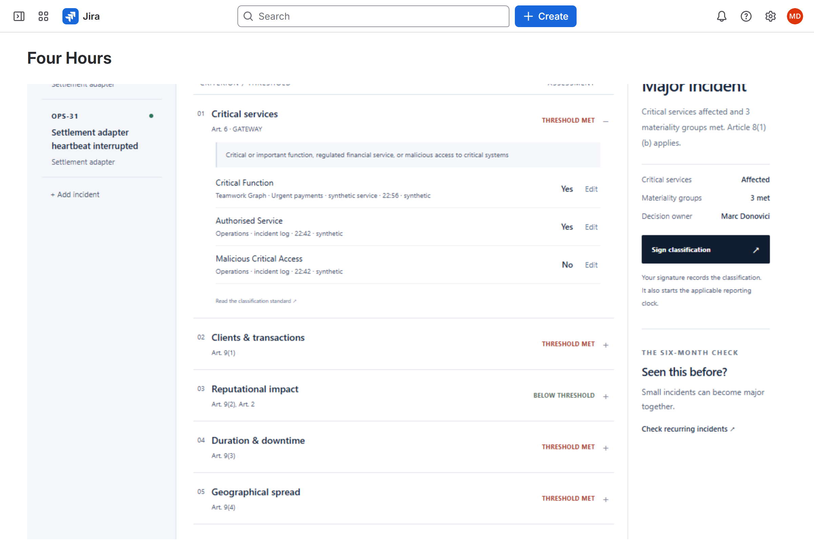
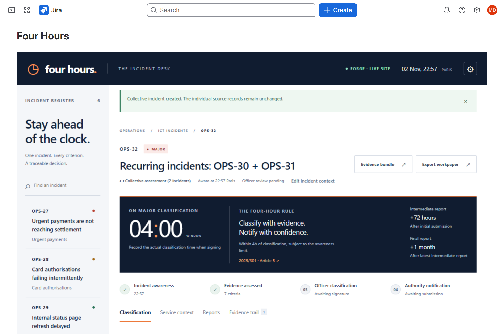
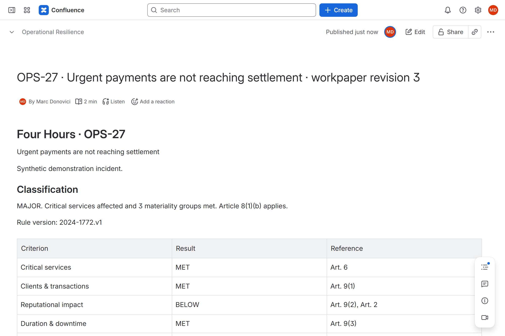
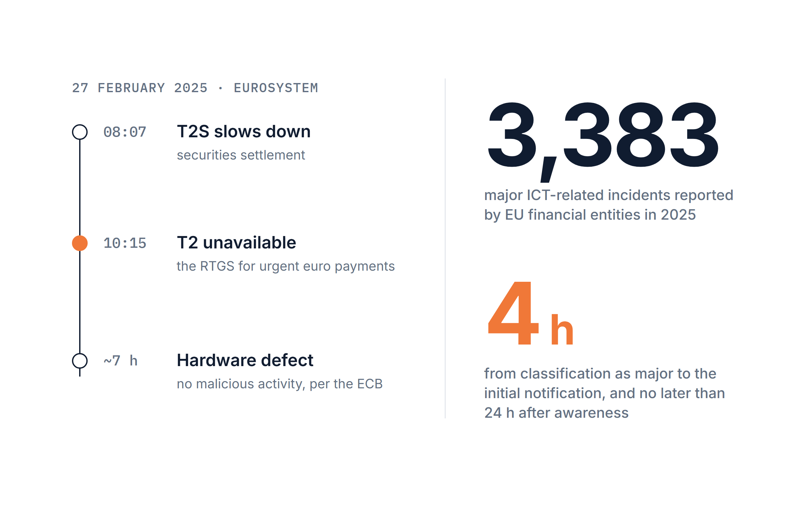
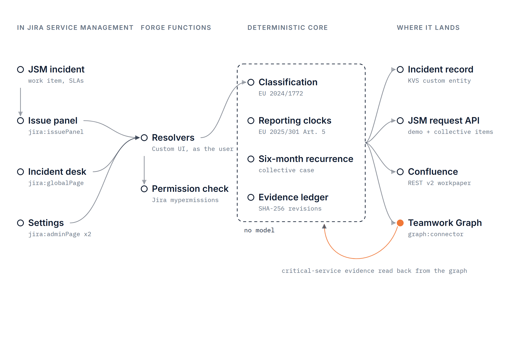
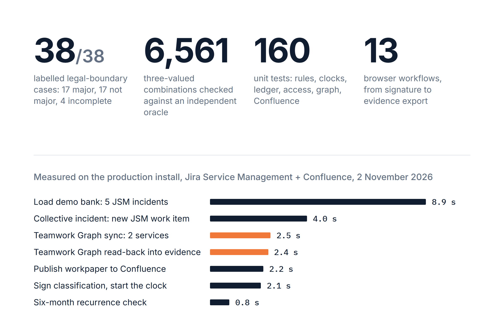

# Four Hours: DORA incident classification in Jira Service Management



    

**Four Hours decides whether an ICT incident is major under DORA, from sourced evidence, inside the Jira Service
Management incident, and starts the four-hour reporting clock when the bank's ICT risk officer signs.**

I audit for a living. I test change-management controls in IT audits at a bank's technology practice.

| | |
|---|---|
| Install | [Installation link](https://developer.atlassian.com/console/install/85a587af-acc6-454e-be6c-dabfb8d0eb66?signature=AYABeK4uKGS%2FbX9QkzTiDJiU2cYAAAADAAdhd3Mta21zAEthcm46YXdzOmttczp1cy13ZXN0LTI6NzA5NTg3ODM1MjQzOmtleS83MDVlZDY3MC1mNTdjLTQxYjUtOWY5Yi1lM2YyZGNjMTQ2ZTcAuAECAQB4CxqLTo9l4lqXuFjNim1xJM%2Bp%2F3TVP9xHS2BrU5DRRucB8LWZAhiaPTac7g8FRIuYLwAAAH4wfAYJKoZIhvcNAQcGoG8wbQIBADBoBgkqhkiG9w0BBwEwHgYJYIZIAWUDBAEuMBEEDA%2BHFVjt7tgKXtBXdwIBEIA7c7aIwMQnOLf7NxdEZLV8UBbfEkE4inFdgDTtgfvFw6x3lFgg%2B3MB1Yp1hNjQB8wyZCr%2BAZ4an5OGPkgAB2F3cy1rbXMAS2Fybjphd3M6a21zOmV1LXdlc3QtMTo3MDk1ODc4MzUyNDM6a2V5LzQ2MzBjZTZiLTAwYzMtNGRlMi04NzdiLTYyN2UyMDYwZTVjYwC4AQICAHi9bVMAkme4qVQX1fQHo6ePw3H40A7cGfz7yrmSfBWMXgFsBbXC6iYHvJFHdb%2F5oH%2FuAAAAfjB8BgkqhkiG9w0BBwagbzBtAgEAMGgGCSqGSIb3DQEHATAeBglghkgBZQMEAS4wEQQMmLL6AuBEWBuXeTGWAgEQgDv0ZFgqAoX8ui6fxdu%2BgHgoxG%2FraAFVlCvXOgBSqnA5c2Yc%2F8%2BOs%2FtZp1oMeukg1BzaJlCZtcH7ps%2FeqwAHYXdzLWttcwBLYXJuOmF3czprbXM6dXMtZWFzdC0xOjcwOTU4NzgzNTI0MzprZXkvNmMxMjBiYTAtNGNkNS00OTg1LWI4MmUtNDBhMDQ5NTJjYzU3ALgBAgIAeDYASx0XCjkny4iLV6vz%2BKtEGSGT6kdt0QRpkn6D%2FlVEATzfL5izvFttq61wiDDEC80AAAB%2BMHwGCSqGSIb3DQEHBqBvMG0CAQAwaAYJKoZIhvcNAQcBMB4GCWCGSAFlAwQBLjARBAwTwKviBDE6gvt6iGUCARCAO8%2FNE3QrkwPk8OZTywFeqtpfQriJLARZuX3FBNEwx%2FzlIPEVNNsuoI1elOmwiL%2F%2B6CqB5M7MMxnmtIsbAgAAAAAMAAAQAAAAAAAAAAAAAAAAAPLGgWe%2F%2FMWjWioNgmKNj9P%2F%2F%2F%2F%2FAAAAAQAAAAAAAAAAAAAAAQAAADLFXeDeQo5X%2B%2FxT1P%2FFc%2Fj2ydQYlsheSmU5EREUlS3fbOCIoedD2211gXvbE%2Bqwn%2B57eRpNxScdCThtL3iR9C6AzqM%3D&product=jira&product=confluence) (Jira Service Management and Jira; Confluence optional) |
| Track | Codegeist 2026 · Apps for Specialized Industries (finance) |
| Bonus | Best Teamwork Graph integration |
| Built with | Forge (Custom UI, resolvers, KVS custom entity, `graph:connector`), Jira Service Management, Jira, Confluence, Teamwork Graph, TypeScript, React |
| Headline result | 38 of 38 labelled legal-boundary cases; 6,561 of 6,561 combinations agree with an independent oracle; on the live site, signing takes 2.1 s and the six-month check 0.8 s |

## For judges

| Criterion | Where to look |
|---|---|
| Technological implementation | [`manifest.yml`](manifest.yml) (issue panel, global page, two admin pages, KVS custom entity, Teamwork Graph connector), [`src/index.ts`](src/index.ts) resolvers, [`src/forge/`](src/forge) (access, Confluence, graph, storage), [live run](#run-live) |
| Design | [See it work](#see-it-work), [the incident desk](src/frontend/main.tsx) |
| Potential impact | [The problem](#the-problem): the T2 outage of 27 February 2025 and 3,383 major ICT incidents reported in 2025 |
| Innovation | [How it works](#how-it-works): unknowns kept visible, signed evidence versions, cross-service six-month recurrence, critical-service evidence from Teamwork Graph |
| Presentation | [Evidence](#evidence), [claims](#claims), [rule sources](docs/SOURCES.md) |

## See it work

You need a Jira Service Management space created from the IT service management template, as a site admin. The
demo incidents belong to a fictional bank.

1. Install with the [installation link](https://developer.atlassian.com/console/install/85a587af-acc6-454e-be6c-dabfb8d0eb66?signature=AYABeK4uKGS%2FbX9QkzTiDJiU2cYAAAADAAdhd3Mta21zAEthcm46YXdzOmttczp1cy13ZXN0LTI6NzA5NTg3ODM1MjQzOmtleS83MDVlZDY3MC1mNTdjLTQxYjUtOWY5Yi1lM2YyZGNjMTQ2ZTcAuAECAQB4CxqLTo9l4lqXuFjNim1xJM%2Bp%2F3TVP9xHS2BrU5DRRucB8LWZAhiaPTac7g8FRIuYLwAAAH4wfAYJKoZIhvcNAQcGoG8wbQIBADBoBgkqhkiG9w0BBwEwHgYJYIZIAWUDBAEuMBEEDA%2BHFVjt7tgKXtBXdwIBEIA7c7aIwMQnOLf7NxdEZLV8UBbfEkE4inFdgDTtgfvFw6x3lFgg%2B3MB1Yp1hNjQB8wyZCr%2BAZ4an5OGPkgAB2F3cy1rbXMAS2Fybjphd3M6a21zOmV1LXdlc3QtMTo3MDk1ODc4MzUyNDM6a2V5LzQ2MzBjZTZiLTAwYzMtNGRlMi04NzdiLTYyN2UyMDYwZTVjYwC4AQICAHi9bVMAkme4qVQX1fQHo6ePw3H40A7cGfz7yrmSfBWMXgFsBbXC6iYHvJFHdb%2F5oH%2FuAAAAfjB8BgkqhkiG9w0BBwagbzBtAgEAMGgGCSqGSIb3DQEHATAeBglghkgBZQMEAS4wEQQMmLL6AuBEWBuXeTGWAgEQgDv0ZFgqAoX8ui6fxdu%2BgHgoxG%2FraAFVlCvXOgBSqnA5c2Yc%2F8%2BOs%2FtZp1oMeukg1BzaJlCZtcH7ps%2FeqwAHYXdzLWttcwBLYXJuOmF3czprbXM6dXMtZWFzdC0xOjcwOTU4NzgzNTI0MzprZXkvNmMxMjBiYTAtNGNkNS00OTg1LWI4MmUtNDBhMDQ5NTJjYzU3ALgBAgIAeDYASx0XCjkny4iLV6vz%2BKtEGSGT6kdt0QRpkn6D%2FlVEATzfL5izvFttq61wiDDEC80AAAB%2BMHwGCSqGSIb3DQEHBqBvMG0CAQAwaAYJKoZIhvcNAQcBMB4GCWCGSAFlAwQBLjARBAwTwKviBDE6gvt6iGUCARCAO8%2FNE3QrkwPk8OZTywFeqtpfQriJLARZuX3FBNEwx%2FzlIPEVNNsuoI1elOmwiL%2F%2B6CqB5M7MMxnmtIsbAgAAAAAMAAAQAAAAAAAAAAAAAAAAAPLGgWe%2F%2FMWjWioNgmKNj9P%2F%2F%2F%2F%2FAAAAAQAAAAAAAAAAAAAAAQAAADLFXeDeQo5X%2B%2FxT1P%2FFc%2Fj2ydQYlsheSmU5EREUlS3fbOCIoedD2211gXvbE%2Bqwn%2B57eRpNxScdCThtL3iR9C6AzqM%3D&product=jira&product=confluence). Open **Apps > Four Hours** and click **Set up the incident
   desk**. Under **Load the demo bank**, choose the service space and click **Load demo bank**. Five incidents
   arrive as JSM requests ("Report a system problem").
2. Open **Urgent payments are not reaching settlement** in the queue, then **Four Hours** from the work item's
   apps button. The panel sits beside the JSM SLAs: critical services affected and three materiality groups met.
3. In the desk, select **Card authorisations failing intermittently**. The client count was never recorded and
   it can change the result, so the verdict is INCOMPLETE and the desk asks for the missing evidence.
4. Connect the connector in admin.atlassian.com (**Connected apps > Four Hours > View app details >
   Connections**). On the urgent-payments incident, **Service context > Sync technical services** writes the
   service register to Teamwork Graph; **Refresh graph evidence** reads the payment service back and cites it in
   the Critical services row.
5. **Sign classification**, then **Confirm classification**. The four-hour clock starts from the classification
   time you record, in the desk and in the JSM incident.
6. On **A second settlement-adapter interruption**, **Check recurring incidents**, then **Create collective
   incident**: a new JSM work item holds the combined assessment.
7. In the settings (gear), choose a Confluence space and **Publish current workpaper**. **Reset the demo** deletes
   the demo incidents so the scenario can be played again.

| Inside the JSM incident | Evidence still missing | Read back from Teamwork Graph |
|---|---|---|
|  |  |  |

| Collective record | Confluence workpaper |
|---|---|
|  |  |

## The problem



On 27 February 2025, T2, the Eurosystem's real-time gross settlement system for urgent euro payments, was
unavailable from 10:15 CET. The ECB attributed it to a hardware defect with no malicious activity, and Reuters put
the disruption at roughly seven hours ([FX News Group](https://fxnewsgroup.com/forex-news/institutional/clearstream-confirms-incident-from-27-february-2025-fully-resolved/), [PaymentsJournal](https://www.paymentsjournal.com/seven-hour-ecb-outage-leaves-trillions-of-euros-in-limbo)).

On such a morning the incident manager knows which service is down. The ICT risk officer has to decide whether the
incident is major under DORA. The initial notification is due within four hours of that classification and no
later than 24 hours after the bank became aware; the intermediate report follows within 72 hours of the initial
one, and the final report one month after the latest intermediate
([Delegated Regulation 2025/301, Article 5](https://eur-lex.europa.eu/eli/reg_del/2025/301/oj/eng)). EU financial
entities reported 3,383 major ICT-related incidents in 2025
([ESAs report, summary](https://finreg.aoshearman.com/esas-2025-report-on-major-ict-related-incidents)).

The decision rests on seven criteria in
[Delegated Regulation 2024/1772](https://eur-lex.europa.eu/eli/reg_del/2024/1772/oj/eng), several facts that are
unknown in the first hour, and incidents that only become major together. Four Hours is for the officer who signs
and the incident manager who runs the incident in Jira Service Management.

## How it works



- **Criterion by criterion.** The critical-services gateway and the six materiality groups each have a row with
  the threshold, the article and the facts behind it. Every fact keeps its value, source, observation time and
  quality. Client and transaction sub-thresholds count as one group.
- **Unknowns stay visible.** The engine returns MAJOR, NOT MAJOR or INCOMPLETE. An unknown fact that could change
  the result makes the verdict INCOMPLETE, and the signature is refused until it is recorded.
- **Signed evidence version.** The officer records the actual classification time and a rationale. The signature
  binds the SHA-256 of that evidence version; the actor comes from the Forge context, not from the request. A
  later evidence change needs a new signature and keeps the first major-classification deadline.
- **Clocks from what happened.** The initial deadline follows the four-hour rule with the 24-hour awareness cap and
  the late-classification case. The intermediate deadline starts from the recorded submission receipt, and the
  final deadline from the latest intermediate, by calendar month. The GDPR Article 33 clock runs separately.
- **Six-month recurrence.** Incidents with the same apparent root cause in the previous six calendar months, across
  services, are assessed together. If they are major together, a separate collective record is created as a new
  work item in the same JSM project; the source incidents stay unchanged. Distinct costs are combined; customer
  counts stay unknown until deduplicated.
- **Critical service from Teamwork Graph.** A Teamwork Graph connector writes the technical service register as
  `atlassian:software-service` objects. Refresh graph evidence reads the affected service back by external ID and
  records its critical-function tag as a cited fact.
- **Workpaper.** Publishing writes the criteria, signature, evidence hash and evidence register to a Confluence
  page as headings and tables, under the user's own Confluence permissions.

Code computes every verdict, deadline and hash. There is no model in the decision.

## How Atlassian is used

| Product | How Four Hours uses it | Why |
|---|---|---|
| Jira Service Management | Demo incidents are created through the JSM request API; the collective record is a new work item in the same project; the panel sits beside the JSM SLAs | The incident already lives there |
| Jira | `jira:issuePanel`, `jira:globalPage`, two `jira:adminPage` modules; permission checks with `mypermissions` for every read and edit; an issue property for structured observations | Incident manager and officer work in the same record |
| Forge | Custom UI and resolvers, KVS custom entity `incident` with versioned writes, `graph:connector` with a connection-change function | No server of my own; data stays on the platform |
| Confluence | REST v2 page creation and a content property for the workpaper | Where review evidence is kept |
| Teamwork Graph | `setObjects` for the software-service objects, `getObjectByExternalId` to read the affected service back into the evidence | The service map is an organisation-wide fact, held once for every incident |

## Boundaries by design

- The officer submits through the competent authority's channel; Four Hours records the receipt reference and
  time, and the next clock starts from it.
- Signing requires a complete assessment, and every edit requires Jira edit permission on the incident.
- Teamwork Graph receives technical service metadata only; clients, transactions and costs stay in Forge storage.

## Evidence



| Check | Result | Reproduce |
|---|---|---|
| Legal-boundary corpus | 38/38: 17 major, 17 not major, 4 incomplete | `npm run eval` |
| Independent truth-completion oracle | 6,561/6,561 three-valued combinations agree | `npm run eval:oracle` |
| Unit tests: rules, clocks, ledger, access, graph, Confluence, recurrence | 160 passing | `npm test` |
| Browser workflows, from signature to evidence export | 13 passing | `npm run test:browser` |
| Type check | clean | `npm run typecheck` |

### Run live

Production install on a Jira Service Management and Confluence site, 2 November 2026, project "Payment Operations"
(OPS), Confluence space "Operational Resilience". Times are measured in the browser, from click to result.

| Action | Result | Time |
|---|---|---|
| Load demo bank | 5 incidents created as JSM requests | 8.9 s |
| Teamwork Graph sync | 2 technical services accepted | 2.5 s |
| Refresh graph evidence | Critical function read back, cited "Teamwork Graph · Urgent payments" | 2.4 s |
| Sign classification | MAJOR signed; initial notification due in 03:58 | 2.1 s |
| Check recurring incidents | 2 incidents, same root cause, MAJOR together | 0.8 s |
| Create collective incident | New JSM work item with the combined assessment | 4.0 s |
| Publish current workpaper | Confluence page with headings and tables | 2.2 s |

## Claims

| Claim | Code | Test |
|---|---|---|
| Client and transaction sub-thresholds count once | `src/core/classify.ts` | `eval/classification.json` case `one-clients-group` |
| An unknown that can change the result gives INCOMPLETE | `src/core/classify.ts` | cases `unknown-can-change`, `zero-denominator` |
| The initial deadline uses the 4 h rule, the 24 h cap and late classification | `src/core/clocks.ts` | `tests/clocks.test.ts` "initial notification" |
| The final deadline uses a calendar month in local time | `src/core/clocks.ts` | `tests/clocks.test.ts` "calendar month" |
| A later signature keeps the first major classification | `src/core/clocks.ts`, `src/core/ledger.ts` | "keeps first major classification on later signatures" |
| The actor comes from the Forge context | `src/forge/access.ts` | `tests/access.test.ts` "derives the actor from Forge context" |
| Edit needs Jira edit permission | `src/forge/access.ts` | "checks edit permission separately from read access" |
| Recurrence matches the root cause across services within six months | `src/core/recurrence.ts` | `tests/recurrence.test.ts` |
| Customer counts are never added without deduplication | `src/core/recurrence.ts` | "never adds people without deduplication" |
| Graph objects carry no impact or customer facts | `src/forge/graph.ts` | "excludes classification and customer-impact facts" |
| The graph read-back needs an explicit critical-function tag | `src/forge/graph.ts` | "requires an explicit classification mapping" |
| The workpaper renders as Confluence headings and tables | `src/forge/confluence.ts` | `tests/confluence.test.ts` |
| A full evidence bundle verifies against a retained digest | `scripts/verify-bundle.mjs` | `tests/jury-improvements.test.ts` |

## Quickstart

Install from the [installation link](https://developer.atlassian.com/console/install/85a587af-acc6-454e-be6c-dabfb8d0eb66?signature=AYABeK4uKGS%2FbX9QkzTiDJiU2cYAAAADAAdhd3Mta21zAEthcm46YXdzOmttczp1cy13ZXN0LTI6NzA5NTg3ODM1MjQzOmtleS83MDVlZDY3MC1mNTdjLTQxYjUtOWY5Yi1lM2YyZGNjMTQ2ZTcAuAECAQB4CxqLTo9l4lqXuFjNim1xJM%2Bp%2F3TVP9xHS2BrU5DRRucB8LWZAhiaPTac7g8FRIuYLwAAAH4wfAYJKoZIhvcNAQcGoG8wbQIBADBoBgkqhkiG9w0BBwEwHgYJYIZIAWUDBAEuMBEEDA%2BHFVjt7tgKXtBXdwIBEIA7c7aIwMQnOLf7NxdEZLV8UBbfEkE4inFdgDTtgfvFw6x3lFgg%2B3MB1Yp1hNjQB8wyZCr%2BAZ4an5OGPkgAB2F3cy1rbXMAS2Fybjphd3M6a21zOmV1LXdlc3QtMTo3MDk1ODc4MzUyNDM6a2V5LzQ2MzBjZTZiLTAwYzMtNGRlMi04NzdiLTYyN2UyMDYwZTVjYwC4AQICAHi9bVMAkme4qVQX1fQHo6ePw3H40A7cGfz7yrmSfBWMXgFsBbXC6iYHvJFHdb%2F5oH%2FuAAAAfjB8BgkqhkiG9w0BBwagbzBtAgEAMGgGCSqGSIb3DQEHATAeBglghkgBZQMEAS4wEQQMmLL6AuBEWBuXeTGWAgEQgDv0ZFgqAoX8ui6fxdu%2BgHgoxG%2FraAFVlCvXOgBSqnA5c2Yc%2F8%2BOs%2FtZp1oMeukg1BzaJlCZtcH7ps%2FeqwAHYXdzLWttcwBLYXJuOmF3czprbXM6dXMtZWFzdC0xOjcwOTU4NzgzNTI0MzprZXkvNmMxMjBiYTAtNGNkNS00OTg1LWI4MmUtNDBhMDQ5NTJjYzU3ALgBAgIAeDYASx0XCjkny4iLV6vz%2BKtEGSGT6kdt0QRpkn6D%2FlVEATzfL5izvFttq61wiDDEC80AAAB%2BMHwGCSqGSIb3DQEHBqBvMG0CAQAwaAYJKoZIhvcNAQcBMB4GCWCGSAFlAwQBLjARBAwTwKviBDE6gvt6iGUCARCAO8%2FNE3QrkwPk8OZTywFeqtpfQriJLARZuX3FBNEwx%2FzlIPEVNNsuoI1elOmwiL%2F%2B6CqB5M7MMxnmtIsbAgAAAAAMAAAQAAAAAAAAAAAAAAAAAPLGgWe%2F%2FMWjWioNgmKNj9P%2F%2F%2F%2F%2FAAAAAQAAAAAAAAAAAAAAAQAAADLFXeDeQo5X%2B%2FxT1P%2FFc%2Fj2ydQYlsheSmU5EREUlS3fbOCIoedD2211gXvbE%2Bqwn%2B57eRpNxScdCThtL3iR9C6AzqM%3D&product=jira&product=confluence) and follow [docs/setup.md](docs/setup.md).

To build and deploy your own copy:

```sh
npm ci
npm test && npm run eval && npm run eval:oracle && npm run typecheck
forge register        # replaces the app id in manifest.yml
npm run deploy        # vite build + forge deploy -e production
forge install -e production
```

For an offline preview, `npm run dev` runs the same engine in the browser with five fictional incidents.

`src/core` holds the decision engine, clocks, ledger, recurrence and reports; `src/forge` the platform adapters;
`src/frontend` the incident desk; `eval` the labelled cases and reports. [Sources](docs/SOURCES.md) lists every
legal interpretation. MIT licensed.
